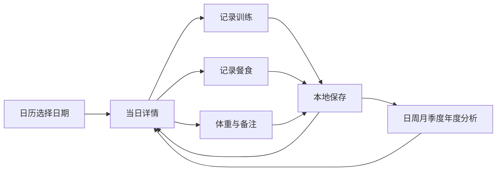

# Design

## Context

项目从空白仓库开始，动机与范围见 [proposal.md](proposal.md)。本设计针对中文个人使用，核心约束是移动端随手记录、健身房断网可用、历史数据可解释。行为合同见各能力规格；当前已推进到 v0.5.0，部署目标确定为 GitHub Pages。

## Goals / Non-Goals

**Goals:** 本地写入不依赖网络；所有页面使用同一聚合规则；饮食和训练修改可立即反映到日历与图表；数据可完整导出、验证和恢复；首版包含五种分析周期。

**Non-Goals:** 首版不引入云端一致性、身份系统和服务端数据库；不通过后台任务、安装权限或第三方食物服务保障核心功能；不建立医疗推断模型，不从训练日志自动推断热量缺口；v0.5.0 独立工具只对用户明确输入进行公式估算。

## Decisions

### 1. 信息架构与交互

底部导航采用“日历、训练、饮食、分析、我的”，五个入口在手机端固定可达。日历作为首页，训练和饮食分别提供当前进行中任务、快捷新增和素材库入口。“我的”提供目标、体重、时区、安装说明、备份恢复和数据管理。

| 页面/地址 | 主要内容 | 核心操作 |
| --- | --- | --- |
| `/calendar?date=YYYY-MM-DD&view=month` | 月/周切换、每日热量和训练标记、选中日摘要 | 切换日期、回今天、打开日详情 |
| `/day/:date` | 营养概览、四类餐次、训练、体重和备注 | 加餐、开始/补记训练、确认饮食完整、标记休息 |
| `/training` | 继续训练、开始训练、模板和历史 | 选择日期、使用模板 |
| `/exercises` | 动作搜索、肌群和器械筛选、收藏 | 查看详情、选入训练、自建动作 |
| `/workouts/:id` | 动作卡片、组次表、上次数据、保存状态 | 加组、标完成、排序、结束训练 |
| `/nutrition?date=YYYY-MM-DD` | 当日餐次、已记录营养、常用和最近食物 | 添加食物、复制历史餐食 |
| `/foods`、`/foods/:id` | 本地食物库及每百克营养/份量 | 自建、收藏、编辑与归档 |
| `/analytics?period=month&anchor=YYYY-MM-DD` | 五种周期切换、指标、图表、覆盖情况 | 上下期、比较、下钻 |
| `/settings` | 档案、目标历史、体重、安装与备份 | 修改生效目标、导出、预览恢复 |

手机日历下方展示选中日摘要，点击详情进入完整时间线；桌面可采用左月历右日详情。日期切换时不丢失未保存输入：先保留草稿，失败时留在当前页并提示。

界面使用中性色背景、深色正文和细边框；动作目录采用紧凑列表，训练采用数据表格。去除英文口号、装饰插画和重复图标，仅在记录状态与图表中使用语义色；状态同时带文字，不依赖颜色。支持深色模式，主要触控目标至少四十四像素，三百六十像素宽度无页面横向溢出，组次表可在局部滚动。表单使用数字键盘和常用步进按钮；图表配数据表，尊重减少动画设置。基础功能遵循 WCAG 2.2 AA 对比度与键盘访问要求。

### 2. 技术选型

| 层次 | 选择 | 原因与替代考量 |
| --- | --- | --- |
| 应用 | React + TypeScript + Vite | 静态部署适合本地应用；首版没有服务端渲染需求，暂不引入 Next.js 服务端 |
| 导航与视图 | React Router 数据 Hash Router、Radix UI 与原生 CSS | GitHub Pages 无法配置路由回退，哈希路由保证直接访问；采用 Radix Dialog/Toggle Group/Tooltip，界面参考 shadcn/ui 的列表、表单和中性色样式 |
| 业务持久化 | IndexedDB + Dexie | 支持事务、索引与模式升级；localStorage 不适合作为大量日志或事务主库 |
| 表单与格式验证 | 原生表单 + Zod | 首版直接共享字段约束与导入校验，减少额外表单依赖 |
| 日期 | date-fns + @date-fns/tz，统一封装日期边界 | 本地日期与 UTC 时间戳分离，避免按固定二十四小时推导日历边界 |
| 图表 | ECharts，按需导入图形模块 | 同时覆盖柱状、折线、堆叠和日历热力图；季度边界与空值由业务层生成 |
| PWA | vite-plugin-pwa + Workbox | 预缓存应用壳与核心资源；选提示更新模式而非强制刷新 |
| 校验 | Vitest、Testing Library、Playwright | 计算口径用确定性单元测试，跨页面、离线和升级用浏览器测试 |

依赖通过锁文件锁定，运行环境使用 Node.js 22 LTS（至少 22.12.0）或受支持的更高 LTS。当前文档校验使用 OpenSpec 1.14.3。

页面表中的路径为应用内地址，实际发布形如 `/RepLog/#/calendar`。Vite 在 GitHub Actions 中根据仓库名计算 base；个人主页仓库默认根路径，自定义域名通过 `PAGES_BASE_PATH=/` 覆盖。manifest 的 id、scope、start_url 与应用壳使用同一 base，本地库名称也包含 base。部署步骤见 [部署文档](../../../docs/github-pages.md)。

`package.json` 是应用版本唯一来源，首个版本为 `0.1.0`；构建注入版本号、提交短标识和构建时间，关于页、导航、页脚及备份复用该值。数据格式与数据库版本独立演进，发布标签为 `v版本号`，检查不符则拒绝发布。

### 3. 模块与数据流

建议目录分为 `src/features/{calendar,exercises,workouts,nutrition,analytics,settings}`、`src/domain`、`src/db`、`src/components`、`src/pwa`。页面经业务命令写入，不能直接修改数据库实体；领域层统一负责数值、日期、状态和聚合。当前版本不设置远程业务 API，未来同步另开规格。

界面只持有表单与导航状态，持久数据以数据库为准。Dexie 的响应式查询在事务成功后通知日历、详情与分析；汇总结果可在内存缓存，以数据修订号和日期窗口作为缓存键，不持久化不可追溯的独立日总量。

每次业务写入在一个读写事务内检查 `revision` 并更新受影响对象。保存成功后递增版本，旧标签提交旧版本则拒绝；BroadcastChannel 辅助提示页面刷新，但不能代替事务内版本检查。重复提交使用业务操作标识去重。

### 4. 数据模型

所有个人实体有 UUID、`createdAt`、`updatedAt`、`revision`；删除历史记录可在事务中直接删除，首版不需要同步墓碑。字典归档保留引用。UTC 时间戳采用 ISO 8601，归属日期采用严格 `YYYY-MM-DD`，记录时区采用 IANA 标识。

| 实体 | 关键字段 | 关系与约束 |
| --- | --- | --- |
| Profile | locale、timeZone、weekStartsOn、units、seedVersion | 单档案；修改时区不迁移历史日期 |
| Muscle / Equipment | id、name、category、source | 肌群与器械字典；内置标识跨版本稳定 |
| Exercise | name、aliases、primaryMuscleIds、secondaryMuscleIds、requiredEquipmentIds、optionalEquipmentIds、type、trackingMode、instructions、source、archived | 模式为负重次数、徒手次数、辅助次数、力量计时、有氧；主要肌群不可空 |
| Favorite | entityType、entityId | 动作/食物与档案内唯一收藏关系 |
| WorkoutSession | localDate、recordTimeZone、startedAt、endedAt、durationSeconds、status、note、completionOperationId | status 为进行中或完成；全局至多一个进行中 |
| WorkoutExercise | sessionId、exerciseId、order、exerciseSnapshot | 名称、肌群、器械、模式快照作为历史与分析依据 |
| WorkoutSet | workoutExerciseId、order、kind、reps、loadGrams、assistanceGrams、durationSeconds、distanceMeters、rpe、completed | kind 为热身或正式；按模式验证适用字段 |
| WorkoutTemplate / TemplateItem | name、order、exerciseId、exerciseSnapshot、targetSets | 保存计划而非实际完成状态 |
| Food | name、brand、energyPer100g、proteinPer100g、carbsPer100g、fatPer100g、servingName、servingGrams、source、archived | 能量必须已知；营养素未知为 null；食物专属份量换算 |
| Meal | localDate、recordTimeZone、mealType、eatenAt、note | 同一天同一餐次允许多个 Meal |
| MealItem | mealId、foodId、grams、enteredQuantity、enteredUnit、foodSnapshot、operationId | 营养来自快照；克重必为正数 |
| DailyJournal | localDate、dietConfirmed、dietConfirmedAt、restDay、note | 无食物且确认完整表示主动零摄入；状态由条目数与确认字段派生 |
| NutritionGoal | effectiveFrom、energyKcal、proteinGrams、carbsGrams、fatGrams | 生效日唯一，结束日为下一版本生效日前一天 |
| BodyMeasurement | localDate、recordTimeZone、weightGrams、note | 每日体重唯一，正数 |

v0.1.0 将会话、餐食、模板作为聚合根，将子动作/组次或食物明细嵌套存储，保持一次编辑原子性；上表的子实体独立标识和关系仍保留在嵌套对象内。索引包括归属日期、会话状态、目标生效日期；目标生效日、体重日期、日记日期建立唯一约束。动作/食物搜索先在本地字典内过滤，后续按实测引入细粒度索引；若拆分子表，需要新增模式迁移。

存储重量为整数克、距离为整数米、时长为整数秒；输入转换后按相应最小单位校验。食物实际克重允许至零点一克，每百克营养保留用户原始有效精度，使用十进制运算处理乘除与累加，显示时再舍入，避免逐条舍入和二进制小数误差。所有导入和表单拒绝 NaN、Infinity、负值及不适用字段组合。

快照是独立历史值，不能只保存字典外键。食物库更正不改变历史快照，动作库肌群更正不重分配历史组数。模板继续保留动作快照，但归档引用使用前要求替换或恢复。内置种子更新通过稳定标识幂等升级，不覆盖个人副本。

### 5. 日期、统计与图表口径

日历范围采用档案时区确定“今天”和新记录日期，统计直接读取记录 `localDate`，不用 UTC 重新推算归属。日期枚举使用日历运算，范围查询内部采用起日含、终日后一日不含。禁止用 UTC 字符串截取或加固定毫秒推导跨夏令时日期。跨日训练整次归属开始日，可由用户修正。

| 指标 | 计算与适用范围 |
| --- | --- |
| 已记录摄入 | 全部食物的快照营养 × 克重 ÷ 100；包含部分记录，明确标注 |
| 完整日平均摄入 | 完整日能量总和 ÷ 完整日数，主动零摄入参与；无分母显示无数据 |
| 饮食覆盖率 | 完整日数 ÷ 周期中不晚于今天的天数；未来周期无分母显示不适用 |
| 营养素小计 | 只累计已知值，并返回是否存在未知项；未知项不变成零 |
| 日能量目标达标率 | 完整且有正目标日期中，摄入位于目标 90%～110% 的天数 ÷ 该样本天数 |
| 目标差 | 已记录能量减当日目标；部分记录仅提示当前已记录差额，不称最终超标或不足 |
| 营养素目标对照 | 有完整营养数据且目标大于零时可计算比值；目标为零只显示克数差，不除以零 |
| 训练次数与天数 | 已完成会话数、已完成会话归属日期去重数；未知日期不等于休息 |
| 正式组数 | 已完成会话中全部正式完成力量组，包含徒手/辅助/力量计时，排除有氧和热身 |
| 外部负重训练量 | 负重次数模式正式完成组之总重量千克 × 次数；其他模式不适用 |
| 肌群分布 | 每个正式力量组按快照中 n 个主要肌群各分配 1/n 组；辅助肌群不重复归属 |
| 有氧 | 已完成会话的正式完成有氧段时长/距离；不与力量计时混合 |
| 会话时长 | 用户确认的 durationSeconds，可预填结束减开始；多会话汇总为会话时长之和，不称净运动分钟 |
| 体重 | 日值唯一；跨日汇总桶取最后测量并注明日期，无测量不插值 |

力量图表同时展示适用组数与正式组数，解释负重训练量仅覆盖部分动作。年度热力图可切换训练完成次数和饮食完整度，空白、休息和已记录零值分别显示。总体卡片和图表从同一聚合函数获取数据，任何页不得自行重写计算公式。

| 周期 | 展示范围 | 主要横轴粒度 |
| --- | --- | --- |
| 日 | 选中自然日 | 摄入按餐次、训练按会话；体重为当日单点 |
| 周 | 包含锚点的周一至周日 | 日 |
| 月 | 锚点所在自然月 | 日 |
| 季度 | 一至三月、四至六月、七至九月、十至十二月 | 周，首尾裁剪到季度内 |
| 年度 | 一月一日至十二月三十一日 | 月，另加按日热力图 |

摄入柱展示已记录值，完整/部分用不同样式，未记录为空；季度/年度桶标出完整日数/已过日数、已知营养覆盖和部分样本。汇总目标线为桶内已过天数的已知目标总和，并显示目标覆盖率；未来部分独立作为计划目标，不混入当前对照。训练空白日标记未记录，在计数汇总中贡献零次已记录训练，但不得解释为真实零运动。

日趋势中的空值保持断点，季度/年度的完整日均值以桶内完整样本计算并带样本数；聚合总和不能再直接平均桶平均值。月目标变更时按逐日目标画阶梯线。所有 tooltip 显示具体范围、单位、样本数及完整度，点击汇总桶进入其日期列表。

上期比较：历史已结束周期使用完整上一自然周期；包含今天的周期视为进行中，将今天的序号作为窗口长度，在当前和上一周期中取共同可用天数。完整日分析与上一日比较；未来周期不提供变化百分比。首页周期总览仍显示原完整范围，比较卡明确显示实际截取窗口。

比较用原始值重新聚合；营养比较双方完整度必须百分之百，营养素还须全部已知。训练变化仅描述已记录次数/组数，附双方完成/休息/未知日期数。上期零值只给绝对差，缺样本不给百分比。没有能量消耗输入时不展示热量缺口，体重变化不归因于某次饮食或训练。

### 6. 离线、安装与更新

Workbox 预缓存应用壳、路由懒加载块、中文动作种子和图标，字体使用系统字体。核心资源全部准备成功且数据库初始化后才显示离线可用。安全来源为 HTTPS，开发时可用 localhost；GitHub Pages 使用哈希路由，无需配置服务端 SPA 回退，离线站点入口由 Service Worker 回退应用壳。

核心记录与图表无需任何网络，不能把“离线”显示成“未同步”失败。本地数据库不进入 HTTP 缓存，版本缓存清理仅针对静态资源。外部参考链接由用户主动打开，设置合适的 referrer 策略，日志不进入查询参数或错误遥测。

更新采用等待提示。存在草稿时先确认本地保存，再由用户触发新 Service Worker 激活和刷新；数据库迁移使用 Dexie 版本事务。其他标签保持旧页面时通过关闭数据库连接和版本提示避免升级阻塞，迁移失败保持原模式并进入只读恢复界面。

数据库升级默认向前兼容一版应用的只读导出；发布前保留旧版备份导出逻辑。不可用新模式的旧应用不得直接回滚写入数据库，应用壳回滚和数据库恢复分开处理。恢复模式可从原始可读表导出带模式版本的完整备份。

### 7. 备份、恢复与数据清理

JSON 顶层结构包含 `formatVersion`、`appVersion`、`exportedAt`、`databaseVersion`、`entities`；档案置于 entities.profile，内置字典及引用快照直接包含在 entities 中。在只读事务中读取一致性快照，不导出派生图表缓存或静态资源缓存。

导入限制为二十 MiB，验证文件尺寸和格式后逐表验证数值、日期、枚举、唯一性、快照、外键与状态约束。用户看到格式版本、记录数量、日期范围和“替换当前全部数据”后确认；导入先在内存构造合法集合，再用一个跨全部业务表的事务执行清空与写入。失败自动回滚，操作期间其他标签暂停编辑，版本检查阻止旧表单重写。

不支持合并导入，避免同标识不同内容和目标日期冲突。较新未知版本拒绝，较旧已知版本通过纯转换生成当前格式并重新验证。备份默认是用户主动生成的本地明文文件，导出入口说明其中含个人记录；不假定 Service Worker 缓存就是备份。

清空需输入“清空全部数据”并最终确认；清除全部个人表、配置与内存派生缓存，通知其他标签重新初始化。静态内置资源可保留，不保存残留个人摘要。若浏览器不支持 IndexedDB 或禁用存储，停止持久化操作并解释原因，不静默退回易丢失的内存保存。

### 8. 验证与性能目标

业务单元测试覆盖份量、快照、null 营养、舍入、目标版本、正式组过滤、肌群分摊、覆盖率和比较窗口。固定时钟覆盖跨年周、闰日、季度边界、夏令时和时区变更。浏览器集成覆盖记录后跨页面一致、重复提交、并发冲突、导入事务回滚、升级和离线重开。

性能基准数据为五年日期、最多一万条餐食明细、十万组训练记录、一千个动作；在具备八 GiB 内存的主流桌面 Chrome 中，完成首次加载后月历切换和年度聚合各三十次，百分之九十五耗时不超过一秒。记录硬件、浏览器版本和数据规模，不能把实验室结果当成所有手机保证。移动端额外人工检查长表单和图表交互；若聚合阻塞主线程再引入 Web Worker。

兼容范围为发布时当前及上一主要版本的 iOS Safari、Android Chrome 与桌面 Chrome/Edge；Firefox 校验核心浏览器读写和离线浏览，安装能力按实际平台降级。Safari 的主屏幕安装、系统回收、独立窗口启动需要真机检查，Playwright 不能替代。浏览器可能主动清理站点存储，设置展示持久存储申请结果及备份建议，不承诺永久保存。

### 9. 动作示范素材

v0.3.0 增加独立于业务数据库的静态示范注册表，按内置动作标识匹配。29 个视频及海报来自逐项核对的 wger CC BY-SA 4.0 素材，作者为 Goulart；公开目录附原始地址、许可、修改记录与哈希。存在歧义的普通/辅助引体重复片段不接入，自建动作不进行名称猜测匹配。

原片只在生成阶段下载到临时目录，发布 H.264 MP4、JPEG 海报及清单，客户端不调用外部 API。播放需用户触发，支持内联、循环与倍速；减少动态效果时默认关闭循环。未匹配或播放失败均保留文字说明与业务记录。

应用壳预缓存包含素材清单与署名，视频和海报按需缓存，避免首次安装下载全部示范。完整保存时校验大小与 SHA-256，缓存名称包含站点路径，媒体 URL 带内容哈希版本。Service Worker 处理完整缓存的 Range 请求；离线播放器优先使用缓存 Blob 地址。媒体不写入业务快照或 JSON 备份，因此不改变数据库和备份格式版本。

素材生成与来源见 [动作示范说明](../../../docs/exercise-media.md)。

### 10. 线条缩略图

v0.4.0 使用本项目绘制的 SVG 线稿和明确的姿势映射，覆盖全部八十四个内置动作。相近动作共享基础几何，器械元素读取动作快照；个人动作使用明确静态占位。线稿随应用代码打包，不扩展业务数据模型。

动作目录、选择器、无视频详情和训练卡片复用同一组件。适合循环的动作在可见区域播放轻量 SVG 动画，IntersectionObserver 与页面可见性限制离屏开销；用户可切换静态图，系统减少动态效果优先。保持类动作采用静态姿势。缩略图不依赖视频下载，既有真人视频入口保留。

详见 [线条缩略图说明](../../../docs/exercise-thumbnails.md)。

### 11. 热量计算和 AI 适配

本地领域层提供十进制食物克重换算、Mifflin–St Jeor 及显式活动系数、MET 总消耗/增量计算。核对 wger 的公开实现和测试示例，独立编码，不引入其服务端依赖。页面 `/calories` 由饮食、设置和侧栏进入，所有本地计算可离线使用；目标在用户确认后交给既有带日期版本的保存命令。估算不混入已记录摄入和训练指标。

`MealEstimateProvider` 为模型无关的服务边界。构建时可配置公开 HTTPS 代理 URL，未配置时关闭且不发请求。服务密钥留在外部代理，不出现在静态构建、URL 或业务备份中。用户同意后只发送当前文字，15 秒超时、可取消、64 KiB 响应上限，使用严格版本、关联 ID、数值范围和 null 语义校验。

AI 输出先进入可编辑内存草稿，展示假设和警告，用户检查确认后通过一个本地事务写入食物与餐食，保留估算来源与原始假设。事务失败全部回滚；修改食物仍取消当天饮食完整确认。AI 配置不进入业务 schema，数据库和备份格式继续为版本一。真实模型代理尚未部署，测试只使用明确的测试适配器。

公式、开源参考位置和范围见 [热量计算](../../../docs/calorie-calculator.md)；代理合同、CORS 和配置方式见 [AI 接入](../../../docs/meal-ai-integration.md)。

## Risks / Trade-offs

- 本地单机数据不能自动跨设备使用 → 首版完整备份迁移，后续单独定义同步冲突与账户规格。
- 浏览器清理或配额不足可能导致无法保存 → 检测存储、请求持久权限、保存状态明确、可导出与恢复。
- 用户漏记影响摄入趋势 → 明确确认完整、样本数、未知日期，比较设定完整度条件。
- 训练量不能直接表达训练刺激 → 分开正式组、负重训练量、徒手次数、有氧，注明口径。
- 中文食物覆盖与动作媒体来源不统一 → 首版自建食物和独立编写动作说明，后续按条目记录数据许可。
- 静态站点托管在部分网络环境访问不稳定 → 核心资源本地化，首次准备后全量离线；部署平台在实施时按实际访问环境选择。

## Migration Plan

当前没有历史业务数据。首次启动在数据库版本一中幂等创建字典和档案，成功缓存后标记可离线。

按 tasks.md 顺序实现并验证。GitHub Actions 在主分支推送时检查，通过匹配版本标签或手动运行发布到 GitHub Pages。预览验证仅使用合成数据；远程仓库为 unknownparticles/RepLog，站点为 https://unknownparticles.github.io/RepLog/，发布结果以 Actions 中对应提交的部署记录为准。

后续每次数据库升级先在旧版代表性备份和大样本上验证迁移、失败回滚及导出；应用壳可回滚到兼容版本，发生不兼容数据回滚时通过受支持备份恢复，不能直接降级模式。当前变更仅在实现及验收完成后归档，不因文档齐备提前归档。
